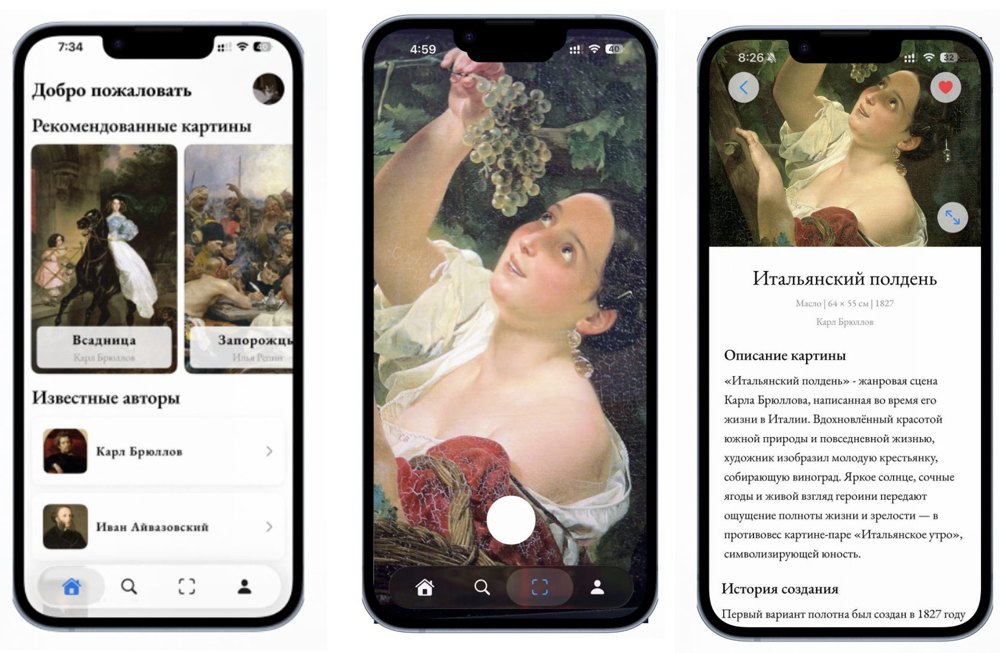
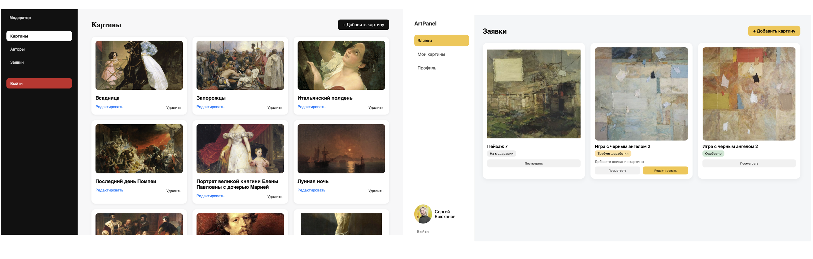

# ArtRecognition — система распознавания произведений искусства

**ArtRecognition** — информационная система для распознавания произведений искусства по фотографии и предоставления подробной информации о картинах и их авторах.

Проект разработан в рамках выпускной квалификационной работы. Его основная цель — расширить доступ к информации о музейных экспонатах с помощью мобильных технологий и компьютерного зрения.

Система включает мобильное iOS-приложение, серверную часть, базу данных PostgreSQL, модуль распознавания изображений и веб-интерфейсы для управления контентом.

## Функциональные возможности

### Мобильное приложение

- **Распознавание картин** — определение произведения искусства по фотографии с использованием модели CLIP.
- **Каталог произведений** — просмотр картин и подробной информации о них.
- **Информация о художниках** — биографии, интересные факты и произведения авторов.
- **Поиск** — поиск произведений искусства.
- **Избранное** — сохранение понравившихся картин.
- **Профиль пользователя** — регистрация, авторизация и редактирование личных данных.
- **Локализация** — поддержка русского и английского языков.

### Веб-интерфейсы

- **Административная панель** — управление пользователями и просмотр статистики системы.
- **Панель контент-менеджера** — добавление, редактирование и удаление информации о картинах и художниках.
- **Интерфейс современного художника** — взаимодействие с системой для размещения собственных произведений искусства.

## Интерфейс iOS-приложения

На изображении представлены основные экраны мобильного приложения: авторизация, стартовый экран с рекомендациями, распознавание произведения искусства и просмотр подробной информации о картине.



## Технологический стек

| Компонент | Технологии |
|---|---|
| Мобильное приложение | Swift, SwiftUI |
| Серверная часть | Python, FastAPI |
| База данных | PostgreSQL, SQLAlchemy |
| Компьютерное зрение | OpenAI CLIP, PyTorch, Hugging Face Transformers |
| Обработка изображений | Pillow |
| Веб-интерфейсы | HTML, CSS, JavaScript |
| Автоматизированное тестирование | XCTest, XCUITest |
| API-документация | Swagger UI, OpenAPI |
| Контроль версий | Git, GitHub |

## Архитектура системы

Система построена на основе клиент-серверной архитектуры.

**iOS-приложение (SwiftUI)** отвечает за взаимодействие с пользователем, отображение информации о произведениях искусства, работу с камерой и отправку HTTP-запросов.

**Backend (FastAPI)** предоставляет REST API для обработки запросов, работы с пользовательскими данными, управления каталогом и распознавания изображений.

**PostgreSQL** используется для хранения информации о пользователях, картинах, авторах, избранном и векторных представлениях изображений.

**Модель CLIP** применяется для извлечения визуальных признаков изображений и поиска наиболее похожего произведения искусства.

### Принцип распознавания изображений

Распознавание реализовано с использованием модели `openai/clip-vit-base-patch32`.

Алгоритм работы:

1. Пользователь фотографирует картину с помощью камеры смартфона.
2. Изображение отправляется на сервер FastAPI.
3. Выполняется предварительная обработка изображения.
4. Модель CLIP извлекает векторное представление изображения — эмбеддинг.
5. Полученный эмбеддинг сравнивается с заранее рассчитанными эмбеддингами произведений искусства, хранящимися в PostgreSQL.
6. Для определения степени сходства используется косинусное сходство.
7. Если найдено достаточно близкое совпадение, приложение отображает информацию о распознанном произведении.

## Веб-интерфейсы системы

Помимо мобильного приложения, в рамках проекта разработаны веб-интерфейсы для работы с произведениями искусства.

**Интерфейс контент-менеджера** позволяет управлять каталогом произведений и сведениями о художниках.

**Интерфейс современного художника** предназначен для взаимодействия с системой и размещения информации о собственных работах.



## Структура репозитория

```text
ArtRecognition-App/
├── HelloApp/
│   ├── HelloApp.xcodeproj/
│   ├── HelloApp/
│   │   ├── Models/
│   │   ├── Recognation/
│   │   ├── Recources/
│   │   ├── Repository/
│   │   └── Views/
│   ├── HelloAppTests/
│   └── HelloAppUITests/
│
├── Backend/
│   ├── admin/
│   ├── ml/
│   │   ├── clip_model.py
│   │   └── fill_embeddings.py
│   ├── moderator/
│   ├── new_author/
│   ├── routers/
│   ├── crud.py
│   ├── database.py
│   ├── dependencies.py
│   ├── main.py
│   ├── models.py
│   ├── schemas.py
│   ├── security.py
│   ├── requirements.txt
│   └── .env.example
│
├── docs/
│   └── images/
│       ├── ios-app.png
│       └── web-interfaces.png
│
├── .gitignore
└── README.md
```

## Автоматизированное тестирование

Для проверки мобильного приложения реализованы модульные и UI-тесты с использованием XCTest.

### Unit-тестирование

Модульные тесты используются для проверки отдельных компонентов бизнес-логики, в том числе валидации пользовательских данных.

Исходный код находится в директории `HelloApp/HelloAppTests`.

### UI-тестирование

UI-тесты автоматизируют пользовательские сценарии, включая ввод данных в формы, взаимодействие с элементами интерфейса и переходы между экранами.

Исходный код находится в директории `HelloApp/HelloAppUITests`.

Для выполнения UI-тестов, взаимодействующих с сервером, необходимо предварительно настроить Backend и тестовую учётную запись.

